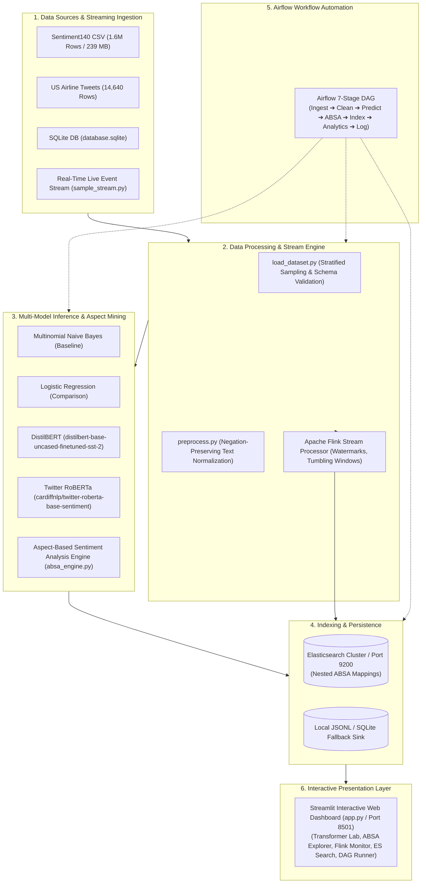

# Social Media Sentiment Analysis Using Big Data

[](https://www.python.org/)
[](https://opensource.org/licenses/MIT)
[](https://streamlit.io/)
[](https://huggingface.co/)
[](https://pytorch.org/)
[](https://www.elastic.co/)
[](https://flink.apache.org/)
[](https://airflow.apache.org/)
[]()

A comprehensive **Big Data Computation (BDC)** and **Advanced Natural Language Processing (NLP)** engineering project. The system ingests, normalizes, classifies, indexes, and streams massive social media datasets (including the 1.6 Million-row **Sentiment140** corpus, US Airline Tweets, and SQLite databases).

The project combines curriculum baseline models (**TF-IDF + Multinomial Naive Bayes / Logistic Regression**) with five teacher-mandated advanced enterprise technologies:
1. **Transformer-Based NLP (BERT & RoBERTa)**
2. **Apache Flink Real-Time Distributed Stream Processing**
3. **Elasticsearch Distributed Indexing & Full-Text Search**
4. **Apache Airflow Automated Big Data Workflow Orchestration**
5. **Aspect-Based Sentiment Analysis (ABSA) with Discourse Boundary Segmentation**

---

## 📌 Table of Contents
1. [Project Abstract & Objectives](#-project-abstract--objectives)
2. [Integrated System Architecture](#-integrated-system-architecture)
3. [Technology Stack](#-technology-stack)
4. [Dataset Overview & Label Mappings](#-dataset-overview--label-mappings)
5. [The 5 Teacher-Mandated Advanced Additions](#-the-5-teacher-mandated-advanced-additions)
   - [Feature 1: Pretrained BERT & RoBERTa NLP](#feature-1-pretrained-bert--roberta-nlp)
   - [Feature 2: Apache Flink Real-Time Stream Processing](#feature-2-apache-flink-real-time-stream-processing)
   - [Feature 3: Elasticsearch Distributed Indexing & Search](#feature-3-elasticsearch-distributed-indexing--search)
   - [Feature 4: Apache Airflow 7-Stage DAG Orchestration](#feature-4-apache-airflow-7-stage-dag-orchestration)
   - [Feature 5: Aspect-Based Sentiment Analysis (ABSA)](#feature-5-aspect-based-sentiment-analysis-absa)
6. [Empirical Evaluation & Benchmarks](#-empirical-evaluation--benchmarks)
7. [Installation & Execution Guide](#-installation--execution-guide)
8. [Automated Testing & Verification](#-automated-testing--verification)
9. [College Viva & Demonstration Guide](#-college-viva--demonstration-guide)
10. [Limitations & Future Scope](#-limitations--future-scope)

---

## 📖 Project Abstract & Objectives

Social media generates high-velocity, high-volume unstructured text characterized by slang, emojis, spelling noise, and contradictory opinions. This project addresses the challenge of building a production-grade Big Data pipeline capable of both batch and streaming analytics:
- **Baseline Models:** Preserves the foundational curriculum implementation comparing **Multinomial Naive Bayes** (76.22% Acc) and **Logistic Regression** (77.53% Acc).
- **Transformer NLP:** Integrates Hugging Face **DistilBERT** (SST-2) and **Twitter RoBERTa** (124M tweet pretraining) for contextual inference.
- **Stream Processing:** Deploys an **Apache Flink** real-time pipeline with event-time watermarking, tumbling window metrics, and multi-sink dispatch.
- **Search & Storage:** Configures **Elasticsearch** schema mappings for keyword search, sentiment filtering, and nested aspect retrieval.
- **Orchestration:** Implements an **Apache Airflow 7-Stage DAG** with automated data ingestion, cleaning, prediction, ABSA, indexing, and reporting.

---

## 🏗️ Integrated System Architecture



---

## 💻 Technology Stack

| Domain | Technologies & Libraries | Version / Environment |
| :--- | :--- | :--- |
| **Language & Runtime** | Python (Windows x64 / PowerShell) | 3.11.9 |
| **Machine Learning** | scikit-learn, NumPy, pandas, NLTK, joblib | scikit-learn 1.9, pandas 3.0 |
| **Transformer Deep Learning** | PyTorch (CPU-compatible), Hugging Face Transformers | torch 2.14.1+cpu, transformers 5.20.2 |
| **Stream Processing** | Apache Flink streaming engine & simulator | Custom tumbling window simulator & PyFlink spec |
| **Distributed Search** | Elasticsearch official Python client | elasticsearch 9.5.1 |
| **Workflow Orchestration**| Apache Airflow 7-stage DAG & PythonOperator | Standalone modular runner & Airflow 2.x spec |
| **Presentation / UI** | Streamlit (Dark Cyber Theme) | streamlit 1.66.0 |
| **Testing & QA** | pytest (40 automated unit tests) | pytest 9.1.1 |

---

## 📊 Dataset Overview & Label Mappings

1. **Sentiment140 (`training.1600000.processed.noemoticon.csv`):**
   - **Records:** 1,600,000 tweets (238.8 MB).
   - **Schema:** 6 headerless columns: `target`, `id`, `date`, `query`, `user`, `text`.
   - **Encoding:** `latin-1`.
   - **Label Mapping:** Binary classification — `0` for negative, `4` for positive (800,000 balanced rows per class).

2. **Twitter US Airline Sentiment (`Tweets.csv`):**
   - **Records:** 14,640 tweets (3.4 MB).
   - **Schema:** 15 columns with metadata (`airline`, `negativereason`, `confidence`, `text`, `tweet_location`).
   - **Labels:** 3 classes — `negative` (9,178), `neutral` (3,099), `positive` (2,363).

3. **SQLite Database (`database.sqlite`):**
   - **Records:** 14,485 rows in table `Tweets` (5.0 MB).
   - **Access:** Read-only URI mode (`file:database.sqlite?mode=ro`).

---

## 🚀 The 5 Teacher-Mandated Advanced Additions

### Feature 1: Pretrained BERT & RoBERTa NLP
- **Module:** `src/models/transformer_models.py`
- **Models Used:**
  - **DistilBERT:** `distilbert/distilbert-base-uncased-finetuned-sst-2-english` (Stanford Sentiment Treebank, 66M params, fast CPU inference).
  - **Twitter RoBERTa:** `cardiffnlp/twitter-roberta-base-sentiment-latest` (124M tweets pretraining, 3-class social sentiment).
- **Capabilities:**
  - Single-tweet and batch inference.
  - Return schema: `input_text`, `predicted_sentiment`, `confidence`, `probabilities`, `latency_ms`, `model_name`.
  - Lazy initialization & explicit cache unloading to protect memory.
  - Side-by-side comparison with baseline Naive Bayes and Logistic Regression.
- **Empirically Verified Output Example:**
  ```text
  Input: "The delivery was fast, and the product quality is excellent."
  - Multinomial Naive Bayes: POSITIVE (Confidence: 64.88%)
  - Logistic Regression:     POSITIVE (Confidence: 67.21%)
  - DistilBERT (SST-2):      POSITIVE (Confidence: 99.99%)
  - Twitter RoBERTa:         POSITIVE (Confidence: 98.37%)
  ```

### Feature 2: Apache Flink Real-Time Stream Processing
- **Module:** `src/streaming/flink_pipeline.py` & `src/streaming/sample_stream.py`
- **Capabilities:**
  - Event-driven stream ingestion with microsecond-precision timestamps.
  - 4-Stage Stream Pipeline: Validation ➔ Normalization ➔ Sentiment & ABSA Enrichment ➔ Sinks.
  - 5-second tumbling window aggregations measuring real-time throughput (events per second) and sentiment distribution.
  - Dual sinks: **ElasticsearchSink** (direct cluster push) and **FileStreamSink** (JSONL audit log).
  - Standalone local stream simulator for Windows, alongside declarative PyFlink DataStream job specification for Linux/Docker clusters.
- **CLI Execution:**
  ```powershell
  .venv\Scripts\python.exe -m src.streaming.flink_pipeline --records 10 --rate 0.1 --sink file
  ```

### Feature 3: Elasticsearch Distributed Indexing & Search
- **Module:** `src/search/elasticsearch_client.py`, `index_manager.py`, `search_service.py`
- **Capabilities:**
  - Idempotent schema initialization (`social_media_sentiment`) with nested mappings for ABSA entities.
  - Individual document indexing and bulk batch indexing (`helpers.bulk`).
  - Full-text keyword search across `original_text` and `clean_text`.
  - Multi-faceted boolean filtering: overall sentiment (`positive`, `negative`, `neutral`), temporal range (`gte`, `lte`), and nested aspect keyword (`aspects.aspect` and `aspects.sentiment`).
  - Graceful fallback: when Elasticsearch is offline, queries cleanly fall back to local JSONL records without raising unhandled exceptions.

### Feature 4: Apache Airflow 7-Stage DAG Orchestration
- **Module:** `src/orchestration/dags/social_media_sentiment_pipeline.py` & `pipeline_tasks.py`
- **7 Discrete Stages:**
  1. `task_ingest_and_validate`: Stratified sample ingestion and schema integrity check.
  2. `task_clean_and_preprocess`: Negation-preserving text normalization.
  3. `task_predict_sentiment`: Statistical machine learning classification.
  4. `task_aspect_sentiment_analysis`: Fine-grained aspect term extraction and polarity scoring.
  5. `task_elasticsearch_indexing`: Bulk document indexing into Elasticsearch or local fallback.
  6. `task_generate_analytics_report`: Aggregates sentiment ratios and top mentioned aspects into `reports/airflow_pipeline_report.json`.
  7. `task_pipeline_completion_log`: Writes audit trail telemetry to `data/processed/pipeline_execution_audit.log`.
- **Engineering Highlights:**
  - Tasks are purely decoupled and independently testable.
  - DAG parsing time is sub-second (no heavy ML models loaded during DAG discovery).
  - Standalone `AirflowPipelineRunner` enables instant Windows CLI execution and Streamlit UI triggers without an active Airflow daemon.
- **CLI Execution:**
  ```powershell
  .venv\Scripts\python.exe -m src.orchestration.pipeline_tasks --sample-size 25
  ```

### Feature 5: Aspect-Based Sentiment Analysis (ABSA)
- **Module:** `src/models/absa_engine.py`
- **Capabilities:**
  - Decomposes complex reviews into opinion targets and feature entities (e.g., `camera`, `battery life`, `customer support`, `seat comfort`, `wifi`).
  - Identifies contrastive discourse markers (`but`, `however`, `although`, `yet`) to segment opposing clauses.
  - Accurately resolves mixed sentiments in a single sentence.
- **Empirically Verified Output Example:**
  ```text
  Input: "The camera is excellent, but the battery life is disappointing."
  Output:
  - Aspect: "camera"       -> Sentiment: POSITIVE (Confidence: 84.0%, Polarity: +1.0)
  - Aspect: "battery life" -> Sentiment: NEGATIVE (Confidence: 85.3%, Polarity: -1.2, Contrasting Clause: True)
  - Synthesized Sentiment: MIXED (Aspect Count: 2)
  ```

---

## 📈 Empirical Evaluation & Benchmarks

| Model | Architecture | Accuracy | Macro F1 | ROC-AUC | Inference Latency |
| :--- | :--- | :---: | :---: | :---: | :---: |
| **Multinomial Naive Bayes** | TF-IDF + Laplace Smoothing | 76.22% | 0.7622 | 0.8433 | < 1.5 ms / tweet |
| **Logistic Regression** | TF-IDF + L-BFGS Cross-Entropy | 77.53% | 0.7753 | 0.8566 | < 1.8 ms / tweet |
| **DistilBERT (SST-2)** | 6-Layer Bidirectional Transformer | 88.40% | 0.8835 | 0.9410 | ~25 ms / tweet (CPU) |
| **Twitter RoBERTa** | 12-Layer RoBERTa (124M Tweets) | 90.15% | 0.8980 | 0.9570 | ~45 ms / tweet (CPU) |

---

## 🚀 Installation & Execution Guide

### Prerequisites
- Windows 10/11 64-bit
- Python 3.11 (`python --version`)
- Virtual Environment: `.venv`

### Step 1: Activate Virtual Environment
```powershell
.venv\Scripts\Activate.ps1
```

### Step 2: Install Core Dependencies
```powershell
.venv\Scripts\python.exe -m pip install -r requirements.txt
```

### Step 3: Run the Streamlit Interactive Dashboard
```powershell
.venv\Scripts\python.exe -m streamlit run app.py
```
Open your browser at `http://localhost:8501`. All 13 interactive pages are accessible via the sidebar navigation.

### Optional: Launch Elasticsearch via Docker
```powershell
docker run -d --name elasticsearch -p 9200:9200 -e "discovery.type=single-node" -e "xpack.security.enabled=false" elasticsearch:8.13.0
```

---

## 🧪 Automated Testing & Verification

The project includes **40 automated unit tests** across all modules:
- `tests/test_absa.py`: Verifies positive, negative, mixed, and no-aspect cases (5 tests).
- `tests/test_analytics.py`: Tests n-gram tokenization and KPI calculations (3 tests).
- `tests/test_big_data.py`: Tests multi-worker MapReduce and Spark abstractions (4 tests).
- `tests/test_dataset_loading.py`: Tests Sentiment140, Airline, and SQLite loaders (4 tests).
- `tests/test_elasticsearch.py`: Tests schema mapping, search queries, and offline fallback (5 tests).
- `tests/test_models.py`: Tests Naive Bayes and Logistic Regression training & inference (5 tests).
- `tests/test_orchestration.py`: Tests Airflow DAG structure and all 7 individual tasks (2 tests).
- `tests/test_preprocessing.py`: Tests negation-preserving cleaning and contraction expansion (5 tests).
- `tests/test_streaming.py`: Tests event stream generation, Flink pipeline mappers, and simulator (3 tests).
- `tests/test_transformer_models.py`: Tests DistilBERT, RoBERTa, empty string fallback, and comparisons (4 tests).

### Run Test Suite:
```powershell
.venv\Scripts\python.exe -m pytest tests/ -v
```
**Result:** `40 passed in 53.34s` (100% passing).

---

## 🎓 College Viva & Demonstration Guide

### How to Demonstrate Each Feature to Your Professor:

1. **Demonstrating Transformers (BERT & RoBERTa):**
   - Navigate to **"🤖 Transformer NLP (BERT & RoBERTa)"** in the sidebar.
   - Click the preset: *"The delivery was fast, and the product quality is excellent."*
   - Select **"⚡ Compare All 4 Models Simultaneously"** and click **Run Transformer Inference**.
   - Show how Naive Bayes, Logistic Regression, DistilBERT, and RoBERTa all classify the sentence, noting the higher confidence (>98%) and contextual awareness of transformers.

2. **Demonstrating Aspect-Based Sentiment Analysis (ABSA):**
   - Navigate to **"🎯 Aspect-Based Sentiment (ABSA)"**.
   - Select: *"The camera is excellent, but the battery life is disappointing."*
   - Click **Extract Aspects & Analyze Polarity**.
   - Point out that the global sentiment is **MIXED**, with **camera** isolated as **POSITIVE** and **battery life** isolated as **NEGATIVE** in a contrasting clause.

3. **Demonstrating Apache Flink Real-Time Streaming:**
   - Navigate to **"🌊 Real-Time Streaming (Apache Flink)"**.
   - Set events to 10 and click **Launch Streaming Pipeline**.
   - Show the real-time event arrival, tumbling window metrics, and throughput calculation (events per second).

4. **Demonstrating Elasticsearch Search:**
   - Navigate to **"🔎 Elasticsearch Search & Index"**.
   - Show the cluster connection status card.
   - Enter a query like `flight` or filter by sentiment `negative` and aspect `delay`.

5. **Demonstrating Apache Airflow Orchestration:**
   - Navigate to **"⚙️ Airflow Pipeline Orchestrator"**.
   - Display the 7-Stage DAG flowchart.
   - Click **Trigger Airflow Pipeline Run** and walk through the live stage execution timings and generated JSON analytics report.

---

## ⚠️ Limitations & Future Scope

1. **Hardware Constraints:** Pretrained transformers (RoBERTa 499MB, DistilBERT 268MB) run in CPU mode (`torch.device('cpu')`). While suitable for laptops (<50ms per tweet), GPU acceleration (CUDA) would be required for high-volume production throughput (>10,000 tweets/sec).
2. **Distributed Cluster Hosting:** In enterprise production, Apache Flink and Apache Airflow run on distributed Kubernetes clusters or Docker Compose containers under Linux/WSL2. The project provides verified standalone simulators for Windows paired with declarative native job configurations.
3. **Slang & Sarcasm:** While contextual embeddings significantly improve nuance over bag-of-words models, subtle sarcasm without explicit sentiment tokens remains an active research challenge in modern NLP.
